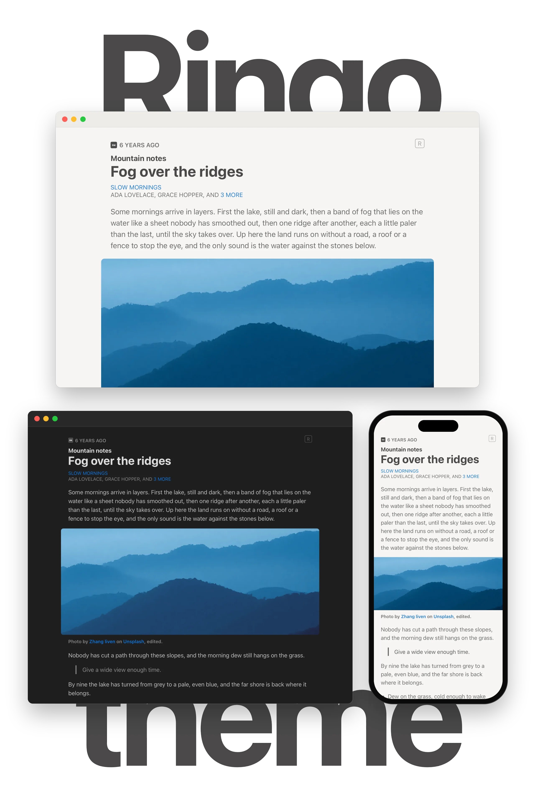

<!-- nnw-theme-identity:start -->

# Ringo

<!-- nnw-theme-identity:end -->

<picture>
  <source media="(prefers-color-scheme: dark)" srcset="screenshots/readme-dark.webp">
  
</picture>

  Ringo is a calm, focused reading theme for <a href="https://netnewswire.com">NetNewsWire</a>,
  inspired by the article design of <a href="https://www.reederapp.com/classic/">Reeder Classic</a>. 
  See it in a live preview on its
  <a href="https://ringo-the.me/?utm_source=nnw-ringo&amp;utm_medium=readme&amp;utm_campaign=introduction">website</a>.

## Highlights

- **Images across the full width.** Photos run into the margins on the Mac and
  from edge to edge on iPhone; their caption stays in the column.
- **Native fonts and colors.** San Francisco in your text size, in colors for
  light and dark mode that meet the WCAG contrast ratio.
- **Comfortable line length.** A narrow column that grows with the text size,
  with headlines in balanced lines.
- **Embedded videos and posts.** Videos fill the column at 16:9; posts from
  social networks are centered like other media.
- **Podcasts.** Episodes play at the end of the article, in a card with their
  cover, a player and their title, length and size.
- **Cards and tables.** Bookmarks and callouts become cards; wide tables and
  code blocks scroll.

With <b>Article JavaScript</b> on in NetNewsWire, the Ringo theme adds more; it stays readable without it.

- **A blue dot for updates.** The theme logo in the article header shows a blue
  dot when GitHub has a new version; its settings install it.
- **Share by email.** The theme settings send the article by email as a clean
  page of text and links, readable in any mail app.
- **Footnotes in place.** Footnotes from common blogs and newsletters open in a
  popover next to their marker; the notes at the end sit apart.
- **Colored code.** Code blocks are colored by their language, with a menu to
  pick another one and a button that copies the code.
- **Relative dates.** The article header tells you how long ago an article came
  out, in your language; a click shows the full date.
- **Sections, links and emphasis.** Headings that link to themselves show a thin
  #; links to other sites are underlined.
- **Abbreviations explained.** Point at or tap a dotted abbreviation, and its
  meaning opens in a small tooltip.
- **Kickers and long bylines.** A topic before a colon moves above the title; a
  long byline names the first two authors and how many more.
- **Short videos in portrait.** Short videos stand upright, other videos keep
  their proportions and fit the window.
- **Cleaner articles.** Hides empty spacer paragraphs and a repeated title, and
  keeps images from being squashed.

## Install

[Add to NetNewsWire](https://jonastaedcke.github.io/nnw-ringo/install/) ·
[NetNewsWire Theme Marketplace](https://dave-atx.github.io/nnw-theme-marketplace/#dejonastaedckethemesringo)

With **Article JavaScript** on, the Ringo theme tells you about new versions
itself (see above). You can also subscribe to the theme's
[release feed](https://github.com/jonastaedcke/nnw-ringo/releases.atom) in
NetNewsWire to hear about updates.

## Credits

- [Ember](https://github.com/dave-atx/ember-nnw-theme) by Dave Marquard: the
  script that opens the footnotes of common providers as popovers builds on its
  footnote adapter (Apache License 2.0).
- [highlight.js](https://highlightjs.org) by Ivan Sagalaev and contributors: the
  syntax highlighting of code blocks (BSD 3-Clause License).
- [nnw-theme](https://github.com/dave-atx/nnw-theme) by Dave Marquard: the
  tooling that checks, renders and packages the theme.
- [Reeder Classic](https://www.reederapp.com/classic/): the inspiration for the
  article design.
- [Zhang liven](https://unsplash.com/@lvenfoto):
  [“Misty blue mountains rise above calm water”](https://unsplash.com/photos/BiLh-YznD0I),
  edited, in the screenshots (Unsplash License).
