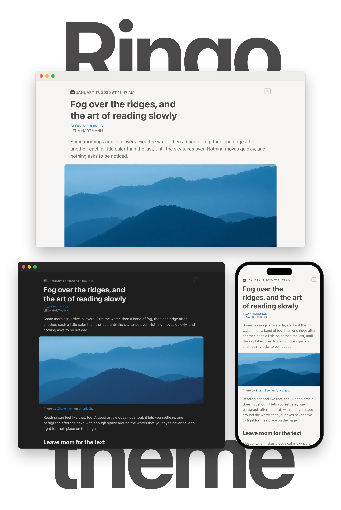

<!-- nnw-theme-identity:start -->

# Ringo

<!-- nnw-theme-identity:end -->

<picture>
  <source media="(prefers-color-scheme: dark)" srcset="screenshots/readme-dark.webp">
  
</picture>

  Ringo is a calm, focused reading theme for <a href="https://netnewswire.com">NetNewsWire</a>,
  inspired by the article design of <a href="https://www.reederapp.com/classic/">Reeder Classic</a>. 
  See it in a live preview on its
  <a href="https://jonastaedcke.github.io/nnw-ringo/?utm_source=nnw-ringo&amp;utm_medium=readme&amp;utm_campaign=introduction">website</a>.

## Highlights

- **Large images, calm layout.** Images extend into the margins, and wide
  tables and code blocks scroll instead of breaking the page.
- **Light and dark.** Follows the system appearance on Mac, iPhone and iPad.
  All text colors meet the WCAG AA contrast ratio, and AAA when Increase
  Contrast is turned on.
- **Your text size.** Follows the text size chosen in NetNewsWire on the Mac
  and Dynamic Type on iPhone and iPad.
- **Comfortable line length.** The article sits in a narrow column that grows
  with the text size, and headlines wrap into balanced lines.
- **System fonts.** Uses the San Francisco family; nothing is downloaded.

### JavaScript

Turn on Article JavaScript in NetNewsWire for Ringo to apply all of its
styles. Ringo stays readable without it.

- **Theme settings.** The R logo in the article header opens the theme
  settings and shows a dot when GitHub has a new version.
- **Cleaner articles.** Hides empty spacer paragraphs and a repeated title,
  and keeps images from being squashed.
- **Footnotes in place.** Opens the footnotes of common providers in a popover
  next to their marker instead of jumping to the end of the article.
- **Better code blocks.** Colors the code by its language and adds a button
  that copies it to the clipboard.
- **Date in your language.** Shows the publication date and time in your language.

## Install

[Add to NetNewsWire](https://jonastaedcke.github.io/nnw-ringo/install/) · [NetNewsWire Theme Marketplace](https://dave-atx.github.io/nnw-theme-marketplace/#dejonastaedckethemesringo)

With Article JavaScript on, Ringo tells you about new versions itself (see
above). You can also subscribe to the theme's
[release feed](https://github.com/jonastaedcke/nnw-ringo/releases.atom) in
NetNewsWire to hear about updates.

## Credits

- [Ember](https://github.com/dave-atx/ember-nnw-theme) by Dave Marquard: the
  script that opens the footnotes of common providers as popovers is adapted
  from its footnote adapter (Apache License 2.0).
- [highlight.js](https://highlightjs.org) by Ivan Sagalaev and contributors:
  the syntax highlighting of code blocks (BSD 3-Clause License).
- [nnw-theme](https://github.com/dave-atx/nnw-theme) by Dave Marquard: the
  tooling that checks, renders and packages the theme.
- [Reeder Classic](https://www.reederapp.com/classic/): the inspiration for the
  article design.
- [Zhang liven](https://unsplash.com/@lvenfoto):
  [“Misty blue mountains rise above calm water”](https://unsplash.com/photos/BiLh-YznD0I)
  (Unsplash License).
