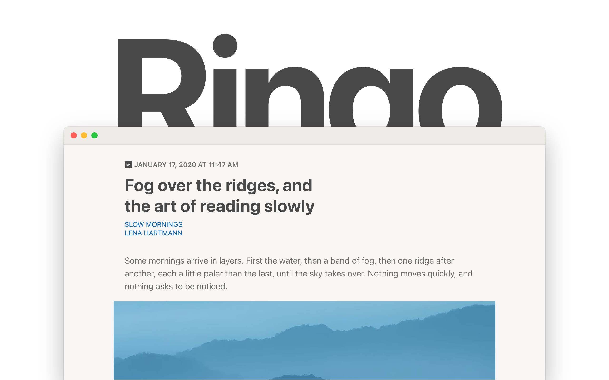

<!-- nnw-theme-identity:start -->

# Ringo

<!-- nnw-theme-identity:end -->

<picture>
  <source media="(prefers-color-scheme: dark)" srcset="screenshots/readme-dark.png">
  
</picture>

Ringo is a calm, focused reading theme for [NetNewsWire](https://netnewswire.com),
inspired by the article design of [Reeder Classic](https://www.reederapp.com/classic/).

## Highlights

- **Large images.** Photos, videos and figures extend into the page margins,
  while their captions stay aligned with the text.
- **Readable contrast.** All text colors meet the WCAG AA contrast ratio of at
  least 4.5:1, and AAA (7:1) when Increase Contrast is turned on, in light and
  dark mode.
- **Light and dark.** Follows the system appearance on Mac, iPhone and iPad.
- **Your text size.** Follows the text size chosen in NetNewsWire on the Mac
  and Dynamic Type on iPhone and iPad.
- **Comfortable line length.** The article sits in a narrow column that grows
  with the text size, and headlines wrap into balanced lines.
- **Calm layout.** Images the publisher floats stay beside the text at no more
  than half the column width, and wide tables and code blocks scroll instead
  of breaking the page.
- **System fonts.** Uses the San Francisco family; nothing is downloaded.

## Install

[NetNewsWire Theme Marketplace](https://dave-atx.github.io/nnw-theme-marketplace/) · [Latest release](https://github.com/jonastaedcke/nnw-ringo/releases/latest)

To hear about new versions, subscribe to the
[release feed](https://github.com/jonastaedcke/nnw-ringo/releases.atom) in
NetNewsWire. It announces updates; it does not install them.

## Development

Ringo's code is written with AI assistance. Every change is reviewed and
tested before release, with renders of sample articles on Mac and iPhone in
light and dark mode.
